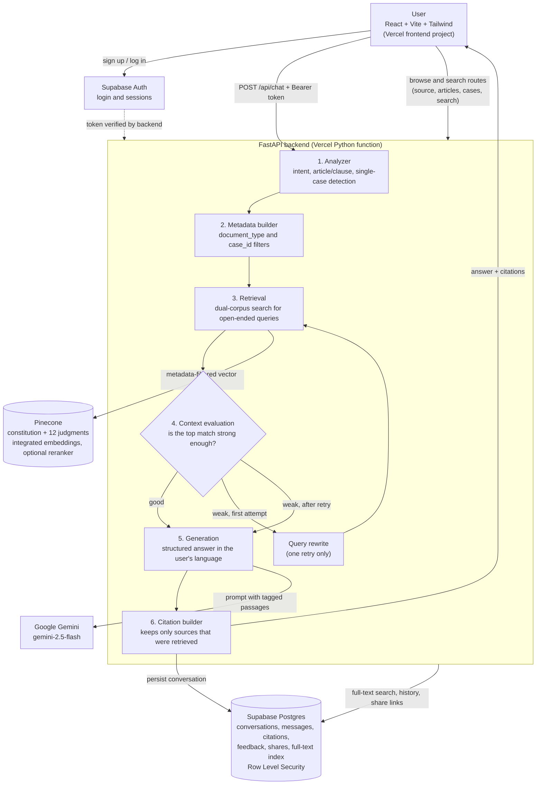

# SamvidhanAI (ConstitutionGPT)

**A citation-grounded research assistant for the Constitution of India** — ask a question in any of the 22 Eighth Schedule languages and get a structured answer where every claim points back to the exact article or Supreme Court judgment it came from.

---

## Features

### Answers you can check
- **Structured answers** — each response has a *Summary*, section headings, *Key Clauses* and an *Explanation*, not a wall of text. The structure is stored with the message, so a conversation reloaded from History looks identical to how it looked live.
- **Per-claim citations** — every section and key clause carries its own clickable citation chips (`Article 21`, `Maneka Gandhi v. Union of India`), not one dumped list at the end.
- **Anti-fabrication by construction** — the model cites raw `source_id`s; the backend resolves each one against what was *actually retrieved* and drops (and logs) anything that wasn't. A model can't cite a source it was never given.
- **Honest about gaps** — if the retrieved context doesn't support an answer, the model is instructed to say so instead of guessing.

### 22-language support
Ask and read answers in **English plus all 22 languages of the Eighth Schedule**, each shown in its own native script in the dropdown:

Assamese · Bengali · Bodo · Dogri · Gujarati · Hindi · Kannada · Kashmiri · Konkani · Maithili · Malayalam · Manipuri · Marathi · Nepali · Odia · Punjabi · Sanskrit · Santali · Sindhi · Tamil · Telugu · Urdu

How it works: the source text is **never translated** (that would compound translation errors and multiply the corpus 22×). Retrieval always runs against the authoritative English text; only the *explanation* is generated in the selected language. Article numbers and case names stay untranslated so citations are identical in every language. The language code is validated server-side against the fixed list. Gemini's fluency varies across languages, especially lower-resource ones such as Dogri, Bodo and Santali.

### Corpus
- The full **Constitution of India** (article-level chunks with article/clause/page metadata)
- **12 landmark Supreme Court judgments** — Maneka Gandhi (1978), Shreya Singhal (2015), Kesavananda Bharati (1973), Golaknath (1967), Minerva Mills (1980), S.R. Bommai (1994), K.S. Puttaswamy (2017), In Re: Article 370 (2023), ADR v. Election Commission (2024), State of Punjab v. Davinder Singh (2024), Property Owners Association (2024), Pooja Ramesh Singh v. J&K Bank (2026)

### Explore, not just chat
The sidebar turns the corpus into a browsable library. Everything opens in the **Source Explorer** panel on the right:

| Sidebar item | What it does |
|---|---|
| **Search Articles → by Number** | Jump straight to any article (`21`, `21A`, `370`) |
| **Search Articles → by Topic** | Semantic search across the whole corpus; ranked results with scores, each expandable to full text |
| **Search Articles → Full-Text** | Exact keyword/phrase match, with the matched text shown in context |
| **Fundamental Rights** | Right to Equality, Freedom, against Exploitation, Freedom of Religion, Cultural & Educational Rights, Constitutional Remedies — each as a stacked list of its articles |
| **Directive Principles** | Socialist, Gandhian and Liberal-Intellectual principles |
| **Case Studies → Landmark Judgments** | The indexed judgments |
| **Case Studies → Case Analysis** | Plain-language significance summaries (see *Known limitations*) |

Looking up a constitutional article also lists the landmark cases that interpret it (for example Article 21 → Maneka Gandhi).

### Accounts and sharing
- Email/password sign-up and login via **Supabase Auth**
- Conversation **history** that persists across sessions
- **Share links** — send a read-only, login-free view of a conversation
- Thumbs-up / thumbs-down **feedback** on any answer
- **Settings** page with account details

### Interface
- Dark navy and gold theme, built with Tailwind CSS and Lucide icons
- **Responsive** — on phones and tablets the sidebar becomes a slide-in drawer, quick-action chips scroll sideways and the Source Explorer goes full-screen; on desktop it's a three-column layout. Checked at 375px, 768px and 1440px with no horizontal overflow.
- Quick-action chips (Preamble, Fundamental Rights, Emergency Provisions, President of India)

---

## How it works



1. **Analyzer** — classifies intent (`article`, `amendment`, `case_law`, `history`, `general`), extracts any explicit article/clause reference, and resolves a query that names exactly one known case.
2. **Metadata builder** — turns intent into filters: article queries search the Constitution, case-law queries search judgments (narrowed to the single case when one is named).
3. **Retrieval** — metadata-filtered semantic search on Pinecone. For open-ended queries it searches the Constitution and the case law *separately* and merges them, so lengthy judgments can't crowd the short, authoritative constitutional text out of the context.
4. **Context evaluation** — if the top match is too weak, the query is rewritten and retrieval retried **once**, then generation proceeds regardless (no infinite loops).
5. **Generation** — Gemini fills a typed schema (summary / sections / key clauses / explanation) in the user's language.
6. **Citation builder** — resolves the model's claimed sources against real retrieval results and builds the final citation list.

Each retrieved passage is tagged `[source_id: …]` in the prompt, which is what lets the model attribute individual claims to individual sources.

## Tech stack

| Layer | Technology |
|---|---|
| Frontend | React 18, Vite, Tailwind CSS, React Router, Lucide React |
| Backend | FastAPI, Pydantic |
| Orchestration | LangGraph, LangChain |
| LLM | Google Gemini (`gemini-2.5-flash`) via `langchain-google-genai` |
| Vector search | Pinecone with integrated embeddings (`llama-text-embed-v2`); optional hosted reranker (`bge-reranker-v2-m3`) |
| Database & auth | Supabase — Postgres, Auth, Row Level Security |
| Full-text search | Postgres `pg_trgm` + GIN index on Supabase |
| Ingestion | pypdf, custom article and paragraph-aware chunkers |
| Hosting | Vercel — two projects (frontend, and the FastAPI backend as a Python serverless function) |

## API

Protected routes need a Supabase access token as `Authorization: Bearer <token>`; read-only reference lookups are public.

| Method & path | Auth | Purpose |
|---|---|---|
| `POST /api/chat` | Yes | Ask a question → structured answer + citations |
| `GET /api/conversations` | Yes | List the user's conversations |
| `GET /api/history?conversation_id=` | Yes | Messages in one conversation |
| `POST /api/feedback` | Yes | Thumbs-up / thumbs-down on a message |
| `POST /api/share` | Yes | Create a share link |
| `GET /api/share/{share_id}` | No | Read a shared conversation |
| `GET /api/source/{source_id}` | No | One article or judgment, plus related cases |
| `GET /api/articles?category=` | No | A named group of articles (Fundamental Rights, DPSP) |
| `GET /api/cases` | No | Indexed landmark judgments |
| `GET /api/cases/analysis` | No | Case significance summaries |
| `GET /api/search?q=` | No | Semantic search |
| `GET /api/search/fulltext?q=` | No | Exact keyword/phrase search |
| `POST /api/auth/signup`, `POST /api/auth/login` | No | Create an account / sign in |
| `POST /api/auth/logout`, `GET /api/auth/me` | Yes | End the session / current user |

Conversations are scoped to their owner in two places: the route checks ownership (returns `403`), and Row Level Security enforces it in the database.

## Repository layout

```
api/              Vercel serverless entrypoint (re-exports backend.main.app)
backend/
  api/routes/     auth, chat, search, sources, articles, cases, feedback, share
  graph/          LangGraph state, workflow and nodes
  rag/            retriever, reranker, prompts
  services/       Pinecone, Supabase, auth
  models/         Pydantic request/response models
  case_law.py     case metadata: single source of truth for ingestion and runtime
frontend/src/     pages, components, auth context, API client
scripts/          ingest → chunk → index pipeline, full-text sync
supabase/migrations/   numbered SQL migrations (001–006)
evaluation/       benchmark datasets, metrics and runners
tests/            backend and RAG unit tests
data/             raw PDFs and processed chunks — gitignored, local only
```

## Getting started

### Prerequisites
Python 3.12, Node 20+, a Pinecone index with integrated embeddings, a Supabase project, and a Gemini API key.

### 1. Backend
```bash
git clone https://github.com/wahid18-maqs/ConstitutionGPT.git
cd ConstitutionGPT && git checkout ml-model
python3 -m venv .venv && source .venv/bin/activate
pip install -r requirements.txt
```
Create `backend/.env`:
```
GEMINI_API_KEY=...
GEMINI_MODEL=gemini-2.5-flash
PINECONE_API_KEY=...
PINECONE_INDEX_NAME=constituteai
PINECONE_NAMESPACE=constitution-v3
RERANK_ENABLED=false
SUPABASE_URL=...
SUPABASE_SERVICE_ROLE_KEY=...
SUPABASE_ANON_KEY=...
ALLOWED_ORIGINS=http://localhost:5173
```
Run it **from the repo root** (not from inside `backend/`):
```bash
PYTHONPATH=. uvicorn backend.main:app --reload --port 8000
```
Locally, any `localhost` / `127.0.0.1` port is accepted for CORS so a shifted Vite port doesn't break anything; in production only `ALLOWED_ORIGINS` applies.

### 2. Database
Apply `supabase/migrations/001` … `006` in order (SQL editor or Supabase CLI). Schema changes go through numbered migration files, not the dashboard.

### 3. Frontend
```bash
cd frontend && npm install
```
Create `frontend/.env`:
```
VITE_API_BASE_URL=http://localhost:8000
VITE_SUPABASE_URL=...
VITE_SUPABASE_ANON_KEY=...
```
```bash
npm run dev
```
The Supabase anon key is *designed* to be public — Row Level Security, not key secrecy, is what protects the data.

### 4. Ingesting data
`data/` is gitignored, so PDFs and processed chunks stay local. Put the Constitution PDF in `data/raw/constitution/` and each judgment in `data/raw/case_law/<case_id>.pdf`, then:
```bash
PYTHONPATH=. python scripts/ingest.py             # PDF → text
PYTHONPATH=. python scripts/chunk.py              # constitution chunks
PYTHONPATH=. python scripts/chunk_case_law.py     # judgment chunks (needs the case in backend/case_law.py)
PYTHONPATH=. python scripts/index.py              # embed + upsert to Pinecone  (--dry-run to preview)
PYTHONPATH=. python scripts/sync_fulltext.py      # refresh the Full-Text Search table
```
Always open each extracted `.txt` and check its header against the case you expect before indexing — a wrong PDF under the right filename is easy to miss.

> **Warning:** `scripts/ingest.py` takes no arguments: it re-extracts **every** PDF under `data/raw/` and overwrites all of `data/processed/*.txt`. Only run it when you intend to re-chunk and re-index. Running it on an already-indexed corpus can leave the processed text out of step with the chunks that are live in Pinecone (different chunk counts mean stale vectors), so it's best to keep a copy of `data/processed/` first.

## Deployment (Vercel)

Two Vercel projects from the same repo, both with **`ml-model` as the Production Branch**:

- **Backend** — Root Directory `.`; the function entrypoint is `api/index.py`, configured in `vercel.json` (60 s max duration). Dependencies come from the root `requirements.txt`, and `.python-version` pins Python 3.12 (newer defaults lack wheels for some pinned packages). **Deleting the root `requirements.txt` breaks the build.**
- **Frontend** — Root Directory `frontend`; `frontend/vercel.json` rewrites every path to `index.html` so deep links like `/chat` survive a refresh.

Set the backend variables above in the backend project (with `ALLOWED_ORIGINS` set to the frontend URL) and the three `VITE_*` variables in the frontend project.

## Testing and evaluation

```bash
python -m unittest discover -s tests/backend -p "test_*.py"   # 32 tests
python -m unittest discover -s tests/rag -p "test_*.py"       # 61 tests
```

**Retrieval eval** — 42 questions run through the real analyzer → metadata → retrieval path, live against Pinecone:

```bash
PYTHONPATH=. python evaluation/runners/run_retrieval_eval.py --live
```

| Category | Questions | Recall@10 | Precision@10 |
|---|---|---|---|
| Explicit article ("What does Article 14 guarantee?") | 16 | 100% | 100% |
| Conceptual ("Can the state deprive someone of liberty without lawful procedure?") | 12 | 100% | 17.4% |
| Case law | 14 | 100% | 100% |

**Generation eval** — 12 questions scoring citation validity/relevance and key-fact coverage with deterministic `sklearn.metrics` checks (no LLM judge, so it fits a free-tier Gemini quota): `run_generation_eval.py`. The runner is built but no results have been recorded yet. See [`evaluation/README.md`](evaluation/README.md).

## Known limitations

- **Conceptual retrieval precision is low (17.4%).** The right article is always found (100% recall), but open-ended questions also pull in loosely related passages. Reranking is implemented (`RERANK_ENABLED`) but off by default and not yet evaluated.
- **Full-Text Search and Case Analysis currently cover only Maneka Gandhi and Shreya Singhal.** Semantic search, chat and the Source Explorer cover all 12 judgments. Extending the others means re-running `scripts/sync_fulltext.py` and writing the analysis text.
- **No Constitutional History section** — there's no ingested source material for Constituent Assembly debates or drafting history, so it isn't shown rather than faked.
- **Article 370 judgment** was ingested from an Indian Kanoon reproduction because the official Supreme Court host was unreachable at the time.
- **Free-tier quotas** (Gemini, Pinecone) bound throughput and the evaluation pacing.
- **Language quality is uneven** across the 22 languages and hasn't been benchmarked per language.
- The brand mark is a generic Lucide `Landmark` icon on purpose — the State Emblem of India is protected under the State Emblem of India (Prohibition of Improper Use) Act, 2005 and isn't used.

## Disclaimer

SamvidhanAI provides general information drawn from the Constitution of India and published Supreme Court judgments. It is a research aid, not a substitute for professional legal advice. Verify anything important against the official text.
